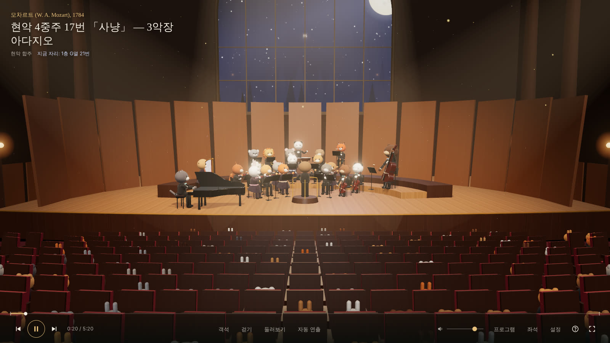
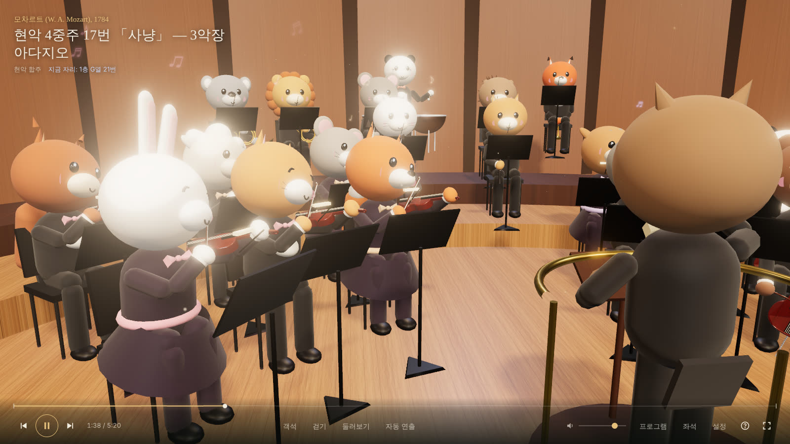
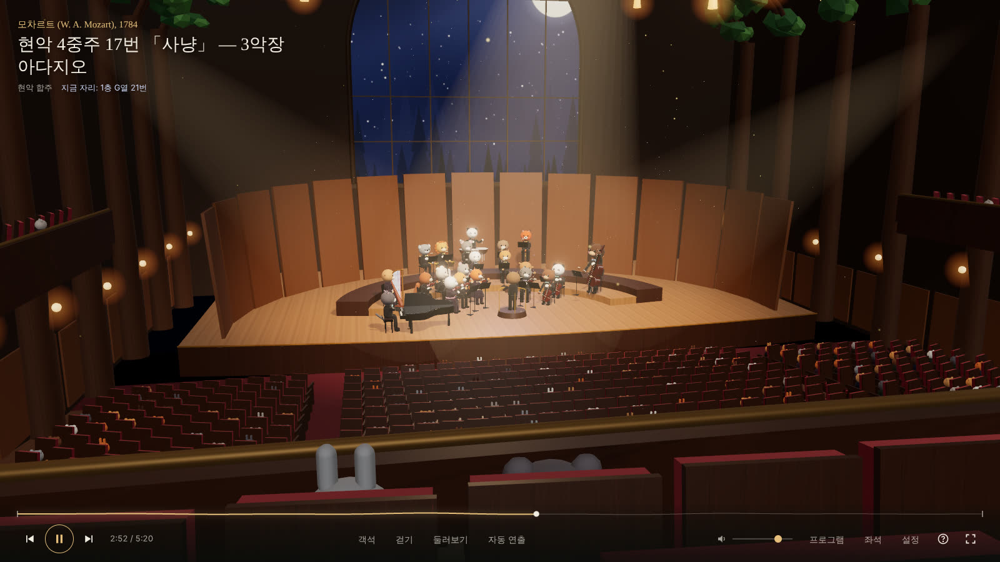
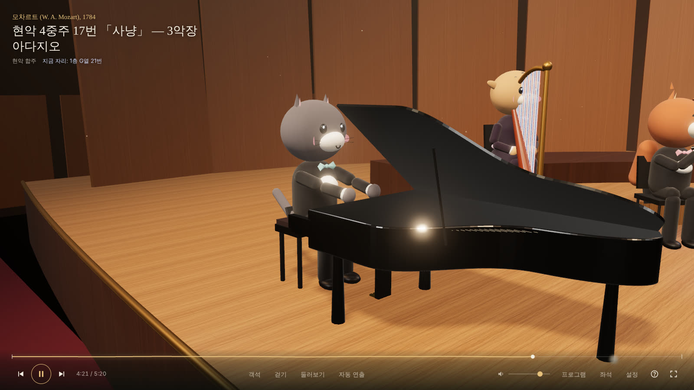
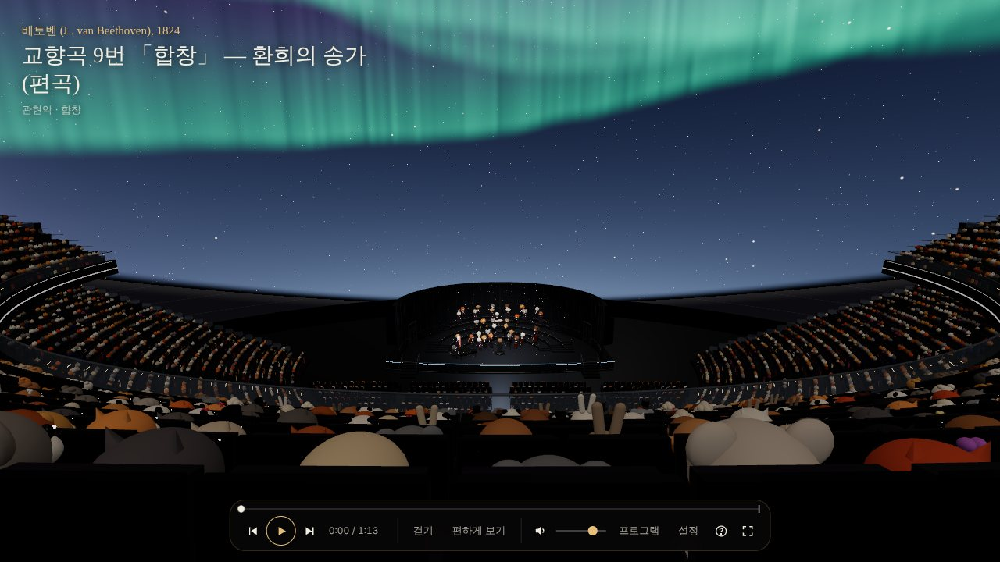
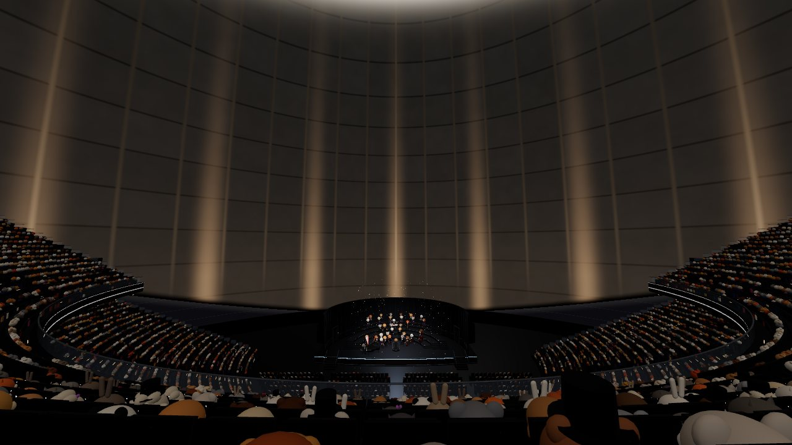
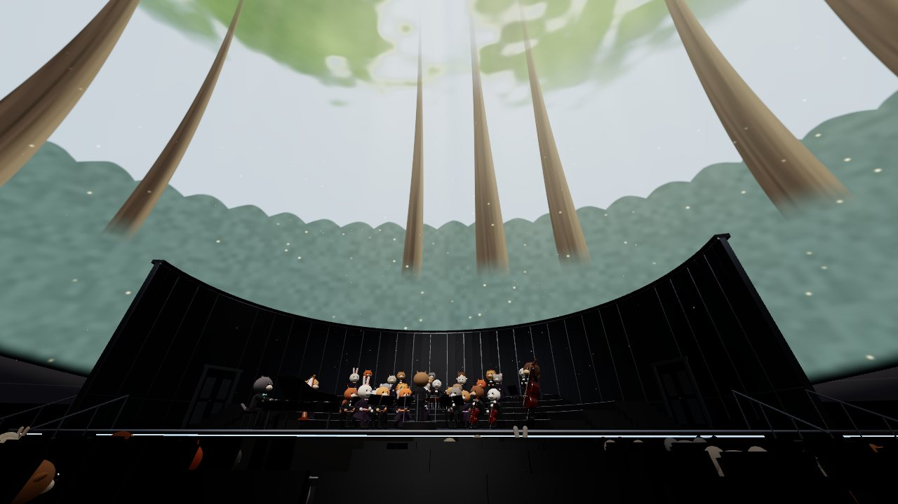
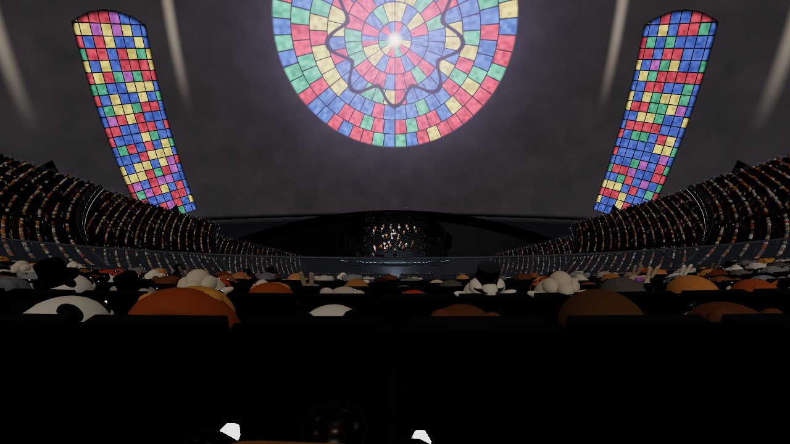
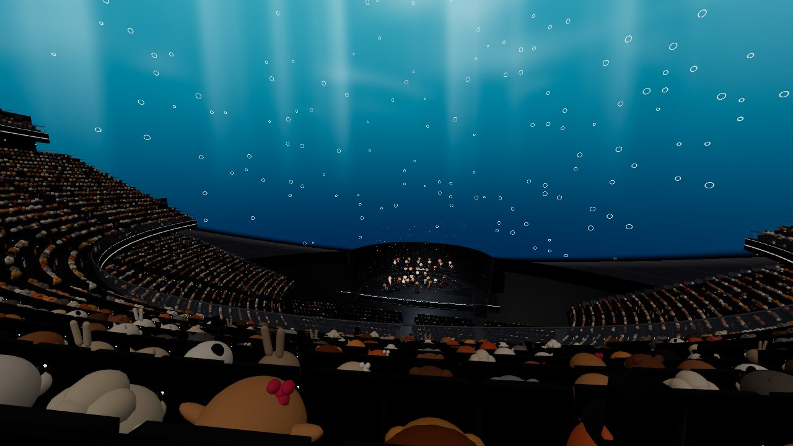
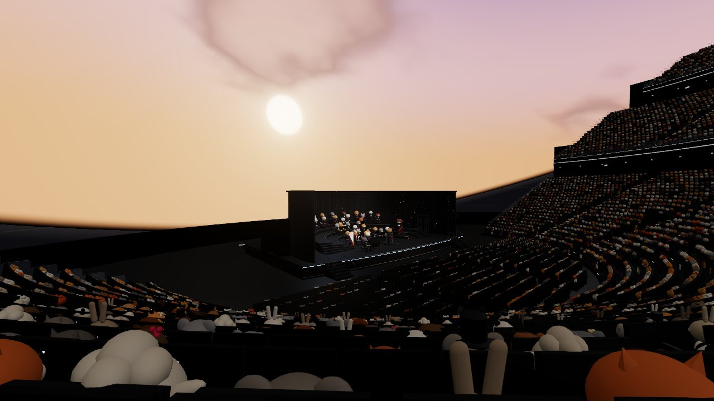

# 🌲🎻 숲속 필하모닉 (Forest Philharmonic)

달빛 숲 가장자리의 4층 그랜드 콘서트홀. 내 컴퓨터에 서버를 띄워 놓고 **로비에서 걸어 들어가 — 나선 계단으로 2·3·4층까지 — 마음에 드는 빈자리에 앉아 "공연 시작"을 누르면**, 숲속 동물 오케스트라와 합창단이 **쉰 곡**의 클래식을 들려줍니다. 영상이 아니라 그 공간에 있는 것처럼 — 자리를 옮기면 소리도 따라 바뀌는 공간 음향, 곡마다 입장하는 지휘자, 박수와 인사, 폭죽과 팡파르까지.

- 실제 악보 데이터(퍼블릭 도메인 곡) × 실제 악기 샘플로 연주 — 녹음 파일을 트는 방식이 아닙니다
- 22명의 동물 연주자 + 12명의 합창단 + 부엉이 지휘자, 4개 층 1,900여 석 (켤 때마다 새로 오는 동물 관객)
- 무대 뒤 대형 스크린에는 공연이 TV 중계처럼 실시간으로 비춰집니다
- 설치할 패키지 없음 (Node.js 하나면 끝)



| 무대 위에서 | 2층 발코니에서 | 피아노 곁에서 |
|---|---|---|
|  |  |  |

### 두 번째 공연장: 스피어 (라스베이거스)

첫 화면에서 **공연장**을 고르면(또는 주소에 `?venue=sphere`) 라스베이거스 스피어 안으로 들어가요. 실제 건물의 비례를 따라 지었어요.



| 공연 전 (건물처럼 보이는 돔) | 플로어에서 (숲) | 400 레벨에서 (성당) |
|---|---|---|
|  |  |  |
| **200 레벨에서 (바닷속)** | **100 레벨 옆에서 (노을)** | |
|  |  | |

- **돔 스크린**: 무대 뒤 바닥 가까이에서 시작해 머리 위를 지나 400 레벨 뒤까지 객석을 감싸는 구형 스크린(실제는 약 15,000 m², 16K×16K, 높이 73 m). 영상 파일이 아니라 실시간으로 그리는 20개의 세계:
  - **날아가는 3D 세계** — 오래된 숲길(나무줄기 사이로 앞으로 걸어 나가요), 바닷속(해초 숲과 모래 바닥, 머리 위 수면과 고래), 노을 진 구름바다(적운 탑 사이를 비행), 오로라 아래 설산(능선 위를 저공비행), 우주 항해(별들이 스쳐 지나가요). 실제 3D 공간을 광선 추적해서 그리기 때문에 깊이와 시차가 있고, 앞으로 나아가는 방향이 무대 쪽이에요.
  - **그림 같은 세계** — 밤하늘·은하수, 오로라, 달빛 구름, 숲 지붕, 바닷속, 노을, 고딕 성당의 장미창, 금빛 유체, 아르데코, 불꽃놀이, 비, 눈, 벚꽃, 성운.
  - 곡마다 어울리는 세계로 바뀌고(긴 곡은 여러 세계를 지나가요), 음악 소리에 맞춰 숨 쉬어요. 3D 세계는 객석 중앙 시점의 큐브맵으로 그려 돔에 입혀요 — 화질 '높음'은 640px로 매 프레임, '보통'은 512px, '낮음'은 384px로 두 프레임마다 필요한 면을 갱신하고, 휴대폰에선 그림 버전으로 바뀌어요. 실행 중 화질을 바꿔도 큐브맵 크기가 함께 바뀌어요.
- **공연 전**에는 스크린이 건물의 콘크리트 돔과 철골, 난간 조명을 비춰서 진짜 지붕처럼 보이다가, 첫 곡이 시작되면 **지붕이 열리듯** 꼭대기부터 세계가 펼쳐져요. 스크린 빛이 객석을 물들여요.
- **IMAG**: 무대 위 돔에 중계 카메라 화면과 곡 자막이 크게 떠요(입장·인사·쉬는 시간, 곡 시작 10초). 곡이 흐르는 동안은 돔 전체가 연출이에요.
- **객석**: 플로어 + 100·200·300·400 레벨, 13,983석. 가파른 캔틸레버 층, 200 레벨이 100 레벨 뒤쪽 위로 내밀어진 구조, 유리 난간과 LED 띠, 난간 아래 무빙 라이트(신나는 곡에선 빔이 무대를 훑어요), 계단 발광등, 섹션 번호(101~407)와 EXIT 표시.
- **이동**: 200 레벨 통로(보미토리)로 들어와요. 통로 끝 **엘리베이터**에서 숫자 키 `1`~`4`(또는 화면 버튼)로 100~400 레벨을 오가고, 100 레벨 계단으로 걸어 내려가면 플로어와 무대 계단이에요. 1만 4천 석 가까운 좌석 전부 입구에서 걸어서(엘리베이터 포함) 갈 수 있는지 검사했어요.
- **소리**: 스크린 뒤 빔포밍 스피커(HOLOPLOT)처럼 — 거리에 따른 감쇠가 홀보다 훨씬 적고, 흡음이 많은 건조한 잔향. 그래도 무대 쪽 방향감은 그대로예요.
- **오늘의 스피어 공연**(26곡, 홀과 겹치지 않아요): 바흐 칸타타의 코랄로 지붕이 열리고, 달빛·숲·빗방울·바다·오로라를 지나, 「트로이카」와 「어메이징 그레이스」의 노을, 그리고 바흐 크리스마스 오라토리오 피날레의 불꽃놀이로 끝나요.
- 같이 보기 방은 공연장마다 따로예요. 다른 공연장의 방 링크로 들어오면 그 공연장으로 옮겨 가요.

---

## 바로 실행하기

필요한 것: **Node.js 18 이상** ([nodejs.org](https://nodejs.org)에서 LTS 설치)

```bash
git clone https://github.com/eddy961206/forest-philharmonic.git
cd forest-philharmonic
npm start
```

터미널에 뜨는 주소를 브라우저에서 열면 됩니다.

```
  이 컴퓨터:     http://localhost:8080
  같은 와이파이: http://192.168.0.12:8080   ← 휴대폰·태블릿·TV에서도 접속 가능
```

- 포트 바꾸기: `PORT=3000 npm start` (Windows PowerShell: `$env:PORT=3000; npm start`)
- 로그 끄기: `QUIET=1 npm start`
- 권장 브라우저: 최신 Chrome / Edge / Safari / Firefox, **헤드폰 사용을 추천**해요 (HRTF 입체음향)
- 휴대폰에서는 자동으로 **가벼운 모드**로 열려요: 처음에는 그림자·후처리 없이, 조명 몇 개만, 관객 최대 홀 200명·Sphere 2,500명, 단순한 좌석, 연주자 팔은 한꺼번에 그리기(인스턴싱), 오디오 24 kHz·모노 샘플을 사용해요. 자동 화질에서는 실제 프레임 시간을 보고 해상도를 조절하며, 여유가 지속되면 해상도와 효과를 보통 단계까지 복구해요. PC에서 설정 → 화질 "낮음"을 고른 뒤 새로고침해도 가벼운 모드가 돼요.

### 계속 켜 두고 싶다면

```bash
# pm2 (재부팅해도 자동 실행)
npm i -g pm2
pm2 start server.js --name forest-philharmonic
pm2 save && pm2 startup

# 또는 Docker
docker build -t forest-philharmonic .
docker run -d --restart unless-stopped -p 8080:8080 forest-philharmonic
```

### 성능 검증하기

추가 패키지 설치 없이 `npm test`로 9개 파일의 69개 회귀 검증을 실행할 수 있어. 지오메트리·좌석 선택과 카메라별 배치, 돔 품질 전환, 중계 화면, 공간 음향, 박수 Worker의 원본 PCM 보존, 음표 스케줄링, 자동 화질의 하강·회복 정책을 확인해. `3f1655` main 통합 뒤 69개를 실제로 실행해 모두 통과했고, 각 파일의 TAP 원본도 남겼어. 로비 음원이 추가·이동할 때의 공간 음향 갱신과 곡 사이의 품질 회복도 포함해. 이전 a41 기준의 59개 전체 검사와 quality 파일 8개 재검사는 별도 기록이야. 상세 실행 기록은 후속 검증 자료 커밋에 함께 남길 예정이야.

```bash
npm test
```

실행 중인 브라우저의 개발자 도구 콘솔에서 한 프레임의 통계를 복사해 볼 수 있어.

```js
({ ...window.__fp.stats })
```

| 항목 | 의미 |
|---|---|
| `calls`, `triangles` | 마지막 앱 프레임에서 실행한 전체 렌더 패스의 draw call·삼각형 합계. 메인 화면, 그림자, 중계 카메라, 돔 큐브맵, 후처리를 포함해. |
| `frameMs` | 직전 `requestAnimationFrame` 콜백부터 지난 실제 시간(ms). |
| `submitMs` | 프레임 함수 시작부터 렌더 제출까지의 경과 시간(ms). 드라이버 대기를 포함할 수 있고, 순수 CPU 시간이나 GPU 완료 시간은 아니야. |
| `fps` | 약 3초마다 갱신하는 화면 프레임 콜백의 평균 빈도. 첫 집계 전에는 0이야. |
| `quality`, `renderScale` | 현재 적용된 화질 단계와 추가 해상도 배율. |

`fps`와 `frameMs`에는 모니터 주사율·브라우저 스케줄링도 영향을 줘. 실제 GPU 처리 시간과 구분해서 보고, 소프트웨어 렌더러의 벤치마크 결과도 실제 PC·휴대폰 GPU 성능으로 환산하지 않아.

변경 전후를 비교할 때는 **화질을 같은 고정값으로 두고, 화면 크기·DPR·카메라 위치/FOV·관객 배치·곡의 시점·돔/중계 상태를 맞춰.** 현재 카운터는 프레임 시작 때 한 번 초기화한 누적값이라, 렌더 호출마다 초기화하던 이전 버전의 `renderer.info` 값과 그대로 비교하면 안 돼. 양쪽에 같은 프레임 누적 계측을 적용한 뒤 비교해야 해.

두 공연장의 전체 장면 측정, 원시 표본과 Windows·macOS/Linux 재현 안내는 현재 검증 중이야. 완료한 결과와 실패·미측정 범위를 구분해서 후속 커밋에 남길게. 벤치마크 도구는 개발 환경에서만 사용하고 앱의 런타임 의존성은 늘리지 않아.

---

## 같이 보기

첫 화면에서 닉네임과 동물을 고르고 **방을 만들거나**(제목, 1~50명, 공개/비공개) 공개 방 목록에서 골라 들어가요. 비공개 방은 방 코드나 초대 링크(`?room=코드`)로만 들어올 수 있어요. 서버가 없는 정적 호스팅에서는 "혼자 보기"만 나와요.

- **방장(👑)** 만 공연 시작, 재생/일시정지, 곡 넘기기, 탐색, 프로그램 선택을 할 수 있어요. 다른 사람에게는 같은 버튼이 잠긴 채로 보여요. 방장이 나가면 가장 오래 있던 사람이 이어받고, 방 패널에서 방장을 넘길 수도 있어요.
- 방장이 하는 일(곡 시작, 재생·멈춤 위치)이 서버 시계 기준으로 전해져서, 모두 같은 마디를 같은 순간에 들어요. 입장·인사 연출은 각자 화면에서 똑같이 펼쳐지고, 늦게 들어오면 공연 중인 자리로 바로 맞춰져요.
- 다른 사람들은 이름표를 단 동물로 보이고, 걷고 앉는 모습이 그대로 보여요. 관객 NPC 배치도 방마다 모두에게 같아요.
- **Enter**(모바일은 "채팅" 버튼)로 채팅. 말이 머리 위 말풍선으로도 떠요.
- 화질·소리·효과 설정은 각자 기기에 맞게 바꿔요.

## 숲속 광장: 표를 사서 들어가요

주소로 처음 들어오면 두 공연장 사이 **숲속 광장**에 서 있어요.

- **나는 랜덤 동물**: 첫 방문 때 동물 하나가 무작위로 정해지고, 그 뒤로 계속 그 동물이에요(바꿀 수 없어요). 이름만 표에 적을 때 바꿀 수 있어요. 광장에서는 내 모습이 보이게 3인칭으로 걸어요.
- **매표소**: 가운데 매표소의 다람쥐 직원에게 가서(**F** 또는 매표소를 눌러 자동으로 걸어가기) ① 공연장(홀·스피어, 오늘의 편성표 26곡씩) ② 관람 방식(혼자 보기 · 단체석 예매 = 방 만들기 · 친구 표 받기 = 방 코드, 지금 열린 공연 목록) ③ 표 받기를 골라요. 값은 동물마다 달라요(다람쥐는 도토리 세 개, 토끼는 당근 두 개, 곰은 꿀 한 숟가락…). 숫자를 세는 돈 로직은 없어요.
- **진짜 같은 표**: 인쇄 띠, 날짜·발권 시각·구역·관객·값 칸, 작은 글씨, 절취선과 홈, 세로 ADMIT ONE, 번호로 그린 바코드, 빨간 일련번호. 홀 표에는 밀랍 도장, 스피어 표에는 홀로그램 포일.
- **입구**: 표를 들면 그 공연장 입구가 빛나요(왼쪽 숲길은 홀, 오른쪽은 스피어). 걸어 들어가면 표가 찢어지고 숲길이 어두워지며 공연장으로 순간이동해요. 공연장 입구에서 표를 확인하고, **입장하기**를 누르면 들어가요.
- **지름길**: 다시 왔을 때는 "지난번처럼 바로 입장", 친구가 보낸 초대 링크(`?room=코드`)는 광장을 건너뛰고 바로 그 방으로 가요. 표 없이 공연장 주소로 오면 광장부터 보여 줘요.
- **나가기**: 공연장 프로그램 패널의 "숲속 광장으로 나가기"나 방 나가기로 광장으로 돌아와요.
- **가벼움**: 광장은 공연장을 불러오기 전의 작은 장면이에요(PC 약 80 드로콜 · 3만 3천 삼각형, 폰 34 드로콜 · 1만 3천 삼각형). 반복되는 건 인스턴싱, 멈춰 있는 건 재질별 병합, 조명 셋, 그림자 없음.
- **터치**: 조이스틱은 반투명하고, 왼쪽 아래 어디를 눌러도 엄지 밑으로 와서 따라와요(놓으면 제자리로).

## 공연은 이렇게 흘러가요

1. 표를 내밀고 입장하면 대리석 로비에 서 있어요. 정면 문으로 1층 객석, 양쪽 나선 계단으로 2층(박스석)·3층·4층에 갈 수 있어요. 빈자리 앞에서 **E**(모바일은 "앉기") — 그 자리에 앉습니다. 다시 E를 누르면 일어나요.
2. 자리를 잡고 **공연 시작**(또는 `Space`)을 누르면, 연주자들이 무대 셸의 문으로 들어와 의자와 보면대를 피해 걷고 단 계단을 올라 자리에 앉습니다. 오보에가 A음을 주면 현악기들이 조율합니다.
3. 지휘자 부엉 선생이 입장해 객석에 인사하고(박수), 돌아서서 지휘봉을 듭니다. 독주곡·실내악은 지휘자가 무대를 비워 줍니다.
4. 곡이 끝나면 박수, 지휘자 인사, 단원들이 일어서서 인사, 지휘자 퇴장. 신나는 곡 뒤엔 색종이, 피날레급 곡 뒤엔 팡파르와 폭죽, 그리고 객석의 박자 맞춘 박수.
5. 곡마다 편성이 바뀌어요. 다음 곡(과 그다음 곡)에 나오지 않는 단원은 곡 사이에 퇴장하고, 필요한 단원이 들어와 앉아요. 피아노 독주곡이면 피아니스트 혼자 걸어 나와 박수를 받으며 객석을 향해 인사하고 앉고, 합창곡이면 합창단이 들어와요. 오케스트라 대부분이 새로 들어오면 오보에에 맞춰 조율해요. '다음 곡'으로 건너뛰면 행렬 없이 바로 그 곡의 배치가 돼요.
6. 곡의 성격마다 시작과 끝이 달라요. **독주회**(피아노 혼자)는 조율 없이 무대 조명이 피아니스트에게 모이고 객석이 더 어두워져요. 레이저와 색종이는 쉬어요. **실내악**은 지휘자 없이 함께 일어나 인사하고, **관현악**은 오보에의 A음과 지휘자로 시작해요. 조용히 끝나는 곡은 마지막 음 뒤에 잠깐 정적을 지킨 뒤 박수가 나와요.
7. 저녁의 큰 순간(첫 곡, 인터미션 뒤 2부, 앙코르)에는 조명이 반쯤 내려가고 객석이 숨을 고르는 몇 초가 지나야 첫 음이 울려요.
8. **인터미션**: 프로그램 한가운데(연주 시간 기준)에서 한 번(설정에서 2·3·5분이나 없음, 방에서는 방장이 정해요). 객석 조명이 올라오고 단원들이 퇴장하고, 로비 소파에서는 첼로 **곰돌**이 2부 곡을 연습해요(로비에선 또렷하게, 홀 안에선 문 너머로 먹먹하게. 스피어에선 무대 위 자기 자리에서). 비워 둔 자리에 비올라 **라쿤**이 슬쩍 앉아 있기도 해요. 도토리 쿠키(**F**)를 건네면 비켜 줘요. 로비 벽 **게시판**에는 2부 첫 곡과 단원 소식이 붙어요. 1분 전과 15초 전에 종이 울려요.
9. **독주회 무대석**: 피아노 독주 중에는 화면 위 칩으로 피아니스트 뒤 **무대 위 자리**나 피아니스트 옆 **악보 넘김이 자리**에 앉을 수 있어요. 피아노 보면대의 악보가 곡에 맞춰 넘어가고, 넘길 때마다 피아니스트가 고개를 끄덕여요. 독주가 끝나면 원래 자리로 돌아가요.
10. **앙코르**: 프로그램이 끝나면 짧은 곡 세 개 중 하나에 **반딧불 랜턴**을 들어요(한 사람에 한 표). 혼자일 땐 내 랜턴이 정하고, 방에서는 방장이 세요(동점이면 방장의 선택). 랜턴이 오를수록 홀의 반딧불이 객석 위로 모여들고, 스피어에선 돔이 별하늘이 돼요.
11. 앙코르가 끝나면 단원들이 퇴장하고 객석 조명이 올라오고, **오늘 밤의 잎사귀 프로그램**이 손에 남아요. 들은 곡, 앉았던 자리, 오래 머문 곳(예: 하프 곁), 함께 들은 사람, 돔 위의 풍경이 적혀 있고, 이 기기에 지난 밤 20개까지 간직돼요(프로그램 패널에서 언제든). 그리고 새 공연이 다시 시작됩니다.
12. **잠들기 전에**(설정): 정한 시간의 마지막 1분에는 조명이 내려가고 관객들이 하나둘 고개를 떨구며 잠들어요. 혼자 볼 때는 마지막 몇 분을 잔잔한 피아노 곡으로 바꿔요. 끝나면 단원들이 살금살금 퇴장하고, 화면 그리기와 소리가 완전히 쉬어요(폰도 화면을 끌 수 있게). 화면을 누르면 깨어나요.

언제든 자리를 옮기고, 무대 앞 계단으로 무대 위에 올라가 연주자 옆에서 들을 수 있어요(연주자 더블클릭). 벽·난간·무대 턱은 막히고, 높이는 계단으로만 바뀝니다.

## 조작법

| 입력 | 동작 |
|---|---|
| `W` `A` `S` `D` / 왼쪽 조이스틱 | 걷기 (`Shift` 달리기) |
| 드래그 | 누른 채 끌어서 둘러보기 |
| 클릭 | 마우스 고정 — 움직이기만 해도 FPS처럼 둘러봐요 (`Esc`로 풀기) |
| `E` / "앉기" 버튼 | 앞의 빈 좌석에 앉기 · 일어서기 |
| 마우스 휠 / 두 손가락 핀치 | 확대·축소 (오페라글라스처럼 시야각 줌) |
| 연주자 더블클릭 (더블탭) | 그 연주자 곁으로 가서 듣기 → "이 파트 크게 듣기"로 솔로 강조 |
| `Space` | 점프 — 난간을 넘어 아래층으로 뛰어내릴 수도 있어요 (모바일은 "점프" 버튼) |
| `K` | 공연 시작 · 재생 / 일시정지 (쉬는 시간에는 바로 다음 곡 시작) |
| `N` / `P` | 다음 곡 / 이전 곡 |
| `←` `→` | 10초 이동 (앉아 있을 때) |
| `1` ~ `4` | (스피어) 엘리베이터 안에서 100~400 레벨로 이동 (모바일은 화면 버튼) |
| `R` | 확대 초기화 |
| `H` | 화면 표시 숨기기 (온전히 감상) |
| `Enter` | 전체 화면 (입장할 때 자동으로 전체 화면) |
| `M` | 음소거 |
| `F` | 가까이 있는 것과 하기: 게시판 읽기, 내 자리에 앉은 라쿤에게 쿠키 건네기 |

"편하게 보기"를 누르면 자동 카메라가 지금 선율을 이끄는 악기를 따라다니며 보여 줍니다. 드래그하면 다시 내 시점으로 돌아와요.

키보드의 미디어 키(재생/다음/이전)와 잠금화면 컨트롤도 동작하고, 재생 중에는 화면이 꺼지지 않게 해 둡니다.

---

## 오늘의 프로그램 (52곡, 공연장마다 26곡)

두 공연장은 곡을 반씩 나눠 가져서, 같은 곡이 두 곳에서 겹치지 않아요. **숲속 필하모닉 홀**은 독주회·현악 4중주·코랄처럼 진짜 공연장 울림이 어울리는 저녁(환희의 송가로 열고 위풍당당 행진곡으로 닫아요), **스피어**는 돔이 가장 잘 그려 내는 곡들의 저녁이에요(지붕이 열리는 코랄로 시작해 바흐 크리스마스 오라토리오의 불꽃놀이로 끝나요). 순서와 구성은 `public/js/programs.js`에서 바꿀 수 있어요.

### 숲속 필하모닉 홀 (26곡, 약 85분)

| # | 작곡가 | 곡 | 편성 | 길이 |
|---|---|---|---|---|
| 1 | 베토벤 | 교향곡 9번 「합창」 — 환희의 송가 (편곡) | 관현악 · 합창 | 1:13 |
| 2 | 베토벤 | 엘리제를 위하여 | 피아노 | 1:05 |
| 3 | 베토벤 | 피아노 소나타 14번 「월광」 — 1악장 | 피아노 | 5:04 |
| 4 | 헨델 | 오페라 「리날도」 — 울게 하소서 | 오보에 · 합창 · 하프 · 현악 저음 | 4:04 |
| 5 | 모차르트 | 피아노 소나타 16번 C장조 K.545 — 1악장 | 피아노 | 2:21 |
| 6 | 하이든 | 현악 4중주 Op.74-1 — 2악장 안단티노 그라치오소 | 현악 4중주 | 6:51 |
| 7 | 베토벤 | 피아노 소나타 8번 「비창」 — 2악장 아다지오 칸타빌레 | 피아노 | 4:29 |
| 8 | 슈베르트 | 겨울 나그네 — 5번 보리수 | 호른 · 피아노 | 4:14 |
| 9 | 쇼팽 | 마주르카 Op.7-1 B♭장조 | 피아노 | 2:07 |
| 10 | 코렐리 | 트리오 소나타 Op.3-1 — 1악장 그라베 | 바이올린 2 · 첼로 · 하프 통주저음 | 1:36 |
| 11 | 그리그 | 서정 소품집 — 아리에타 | 피아노 | 0:56 |
| 12 | 모차르트 | 현악 4중주 17번 「사냥」 — 3악장 아다지오 | 현악 합주 | 5:20 |
| 13 | 스카를라티 | 건반 소나타 D단조 K.1 | 피아노 | 1:06 |
| 14 | 바흐 | 마태 수난곡 — 코랄 「오 피와 상처로 가득한 머리여」 | 합창 · 관현악 | 1:23 |
| 15 | 스콧 조플린 | 솔레이스 — 멕시코 세레나데 | 피아노 | 2:18 |
| 16 | 쇼팽 | 전주곡 6번 B단조 (첼로와 현악 편곡) | 첼로 · 현악 합주 | 1:21 |
| 17 | 베토벤 | 피아노 소나타 20번 G장조 — 1악장 | 피아노 | 4:05 |
| 18 | 슈만 | 어린이 정경 — 1번 미지의 나라들 | 피아노 | 1:10 |
| 19 | 모차르트 | 현악 4중주 1번 K.80 — 1악장 아다지오 | 현악 합주 | 3:44 |
| 20 | 쇼팽 | 전주곡 7번 A장조 | 피아노 | 0:37 |
| 21 | 스콧 조플린 | 메이플 리프 래그 | 피아노 | 5:33 |
| 22 | 바흐 | 크리스마스 오라토리오 — 코랄 「밝아오라, 아름다운 아침 빛이여」 | 합창 · 목관 · 현악 | 1:12 |
| 23 | 쇼팽 | 마주르카 Op.68-2 A단조 | 피아노 | 3:51 |
| 24 | 베토벤 | 피아노 소나타 17번 「템페스트」 — 3악장 | 피아노 | 4:47 |
| 25 | 베토벤 | 현악 4중주 「라주모프스키」 2번 — 2악장 몰토 아다지오 | 현악 합주 | 12:41 |
| 26 | 엘가 | 위풍당당 행진곡 1번 — 트리오 「희망과 영광의 땅」 | 관현악 · 합창 | 2:06 |

### 스피어 (26곡, 약 86분)

| # | 작곡가 | 곡 | 편성 | 길이 |
|---|---|---|---|---|
| 1 | 바흐 | 칸타타 「눈 뜨라고 부르는 소리 있어」 — 종결 코랄 | 합창 · 관현악 | 1:32 |
| 2 | 드뷔시 | 베르가마스크 모음곡 — 달빛 | 피아노 | 5:24 |
| 3 | 바흐 | 평균율 클라비어곡집 1권 — 전주곡 C장조 | 하프 · 첼로 | 2:30 |
| 4 | 쇼팽 | 전주곡 15번 D♭장조 「빗방울」 | 피아노 | 5:20 |
| 5 | 모차르트 | 피아노 소나타 11번 — 3악장 터키 행진곡 | 피아노 | 2:04 |
| 6 | 차이콥스키 | 사계 — 6월: 뱃노래 | 피아노 | 5:22 |
| 7 | 스콧 조플린 | 엔터테이너 | 피아노 | 3:27 |
| 8 | 영국 민요 | 그린슬리브스 (편곡) | 플루트 · 하프 · 현악 | 1:27 |
| 9 | 슈만 | 어린이 정경 — 7번 트로이메라이 (꿈) | 피아노 | 2:42 |
| 10 | 그리그 | 서정 소품집 — 트롤의 행진 | 피아노 | 3:07 |
| 11 | 드뷔시 | 베르가마스크 모음곡 — 전주곡 | 피아노 | 3:44 |
| 12 | 릴리우오칼라니 | 알로하 오에 | 플루트 · 합창 · 현악 · 하프 | 1:07 |
| 13 | 쇼팽 | 전주곡 4번 E단조 (오보에와 현악 편곡) | 오보에 · 현악 합주 | 1:57 |
| 14 | 그리그 | 서정 소품집 — 봄에게 | 피아노 | 5:32 |
| 15 | 베르디 | 오페라 「리골레토」 — 여자의 마음 (편곡) | 호른 · 트럼펫 · 현악 | 0:56 |
| 16 | 차이콥스키 | 사계 — 10월: 가을의 노래 | 피아노 | 3:46 |
| 17 | 그리그 | 서정 소품집 — 나비 | 피아노 | 1:30 |
| 18 | 베버 | 클라리넷 콘체르티노 E♭장조 | 클라리넷 독주 · 현악 합주 | 7:52 |
| 19 | 그리그 | 서정 소품집 Op.54 — 4번 녹턴 | 피아노 | 3:11 |
| 20 | 드뷔시 | 베르가마스크 모음곡 — 파스피에 | 피아노 | 5:35 |
| 21 | 바흐 | 크리스마스 오라토리오 — 목가풍 코랄 「우리는 주님께 노래하네」 | 합창 · 플루트 · 오보에 · 현악 | 1:18 |
| 22 | 차이콥스키 | 사계 — 11월: 트로이카 | 피아노 | 3:46 |
| 23 | 미국 찬송가 | 어메이징 그레이스 (편곡) | 플루트 · 하프 · 합창 · 관현악 | 1:56 |
| 24 | 쇼팽 | 전주곡 20번 C단조 (금관과 현악 편곡) | 금관 · 현악 합주 | 1:08 |
| 25 | 그리그 | 서정 소품집 — 트롤하우겐의 결혼식 날 | 피아노 | 6:05 |
| 26 | 바흐 | 크리스마스 오라토리오 — 피날레 코랄 「이제 너희는 원수를 갚았도다」 | 합창 · 관현악 총주 (트럼펫 · 팀파니) | 3:06 |

「편곡」이라 적힌 곡은 피아노곡·성악곡을 이 악단 편성에 맞게 다시 배치한 것이고, 환희의 송가·엘리제를 위하여·그린슬리브스·어메이징 그레이스(「뉴 브리튼」 선율, 1835)·위풍당당 행진곡 1번 트리오(엘가, 1901)는 코퍼스에 없어 직접 옮겨 적고 편곡했어요. 무작위 순서·한 곡 반복·곡 사이 쉬는 시간은 설정에서 바꿀 수 있어요.

---

## 어떻게 만들었나

### 음악: 악보 → 연주

`tools/build_music.py`가 악보를 "연주"로 바꿉니다. 단순한 MIDI 재생이 아니라 해석이 들어가요.

- **악보 소스**: music21 코퍼스(MusicXML), DCML 주석 코퍼스(MuseScore 기반 노트 테이블), Craig Sapp의 Humdrum **kern 에디션(쇼팽·모차르트·베토벤·조플린·스카를라티), 그리고 직접 적은 악보(코드 기호 → 성부 자동 배치)
- **반복 기호 펼치기**, 붙임줄 병합, 꾸밈음 처리
- **셈여림** (pp~ff, sf, fp, 크레셴도/디미누엔도 쐐기) → 벨로시티
- **스타카토·악센트** 같은 아티큘레이션 반영
- **마디별 템포 맵**: 곡마다 템포·루바토·리타르단도를 손으로 설계 (예: 달빛은 악보의 `Tempo rubato`, `Un poco mosso`, `En animant`, `Calmato`, `morendo` 지시를 따라 19개 키프레임)
- **페르마타**는 실제로 늘려서 연주, 곡 끝 리타르단도
- **피아노 자동 페달**: 베이스가 바뀌는 지점에서 페달을 갈아 밟는 것처럼 음을 이어 줌, 멜로디(오른손 윗성부)는 살리고 내성은 살짝 눌러 주는 보이싱
- **오케스트레이션**: 4중주를 현악 합주로 키울 때 첼로 선율을 콘트라베이스가 옥타브 아래로 받쳐 주되, 첼로가 높이 올라가면 베이스는 빠지는 실제 관행대로. 피아노곡을 편곡할 때는 음역대별로 성부를 나누고 최상성부를 선율 악기에 맡김
- **합창**: 바흐 코랄·헨델·환희의 송가 등에서 SATB 네 성부를 합창단(아 모음·우 모음 샘플)이 부르고 관현악이 콜라 파르테로 받침

### 소리: 공간 음향 엔진 (Web Audio)

```
음표 ─► 섹션 입력 ─(모노 합산)─┬─► 공기 흡수 LPF(거리) ─► HRTF 패너 ─► 직접음 ─┐
                               └─► 잔향 센드 ─► 홀 컨볼루션 리버브 ───────────┤
                                                                               ▼
                            메이크업 게인 ─► 글루 컴프레서 ─► 볼륨 ─► 리미터 ─► 출력
```

- 섹션(제1바이올린, 첼로, 호른, 합창단 …)마다 무대 위 실제 위치에 **HRTF 3D 패너**를 두고, **청취자 위치/방향 = 카메라**를 매 프레임 갱신 → 앉은 자리, 고개 방향, 걷는 위치에 따라 방향감과 거리감이 바뀝니다.
- 직접음은 거리에 따라 줄고 잔향은 홀 전체에 고르게 퍼지므로, **앞자리는 또렷하고 뒷자리·발코니는 잔향이 풍부**해지는 실제 홀의 직접음/잔향 비율이 자연스럽게 생깁니다.
- 멀어질수록 고음이 깎이는 **공기 흡수**, 악기별 **지향성**(호른은 벨이 뒤를 향하므로 뒤로 방사)
- **홀 잔향**은 초기 반사음 + 고역이 먼저 사라지는 확산 꼬리로 직접 합성 (RT60 ≈ 2.35초, 콘서트홀의 따뜻한 저역 비율)
- **세기에 따라 음색이 밝아지는** 벨로시티 필터, 긴 음의 메사 디 보체(부풀었다 잦아드는 표현)
- 샘플보다 긴 음은 지속 구간을 **등전력 크로스페이드**로 이어 붙여 루프 클릭 없이 유지
- 섹션마다 미세한 타이밍 개성(베이스는 아주 살짝 늦게, 악장은 살짝 앞서게)과 휴머나이즈
- 백그라운드 탭에서도 끊기지 않도록 **Worker 기반 스케줄러**와 적응형 룩어헤드

### 화면: 3D 공연장 (three.js)

- 음향적으로 검증된 **슈박스형 홀**을 4개 층으로: 경사진 1층, 앞으로 휘어진 2·3·4층 발코니와 벽을 따라 이어지는 사이드 갤러리, 2층에는 금박 의자가 놓인 박스석
- 월넛 웨인스코트와 플루트 목재 벽, 금박 몰딩과 코퍼(격자) 천장, 크리스털 샹들리에 3개, 금빛 오르간 파이프, 무대 뒤 아치 창으로 보이는 달밤의 숲
- 로비: 대리석 체커 바닥, 레드 카펫, 층마다 갤러리, 1층부터 4층까지 이어지는 **나선 계단 두 개**, 층 안내 사인
- 좌석도 자리마다 달라요: 1층 벨벳 극장 의자, 1층 중앙 E~L열 프리미엄석(넓고 단추 장식), 2층 박스의 루이 양식 금박 암체어(뒷줄은 단 위), 층마다 다른 벨벳 색
- **걷기 = 실제 바닥**: 무대·단·계단·경사 객석·발코니 단·나선 계단이 모두 높이 함수로 정의되어, 메시와 걷기와 단원들의 동선이 같은 바닥을 씁니다. 0.45m 넘는 턱은 못 올라가고 떨어지지도 않아요
- PBR 재질: 바니시 칠한 현악기는 클리어코트, 털은 시언(sheen), 래커 칠한 그랜드피아노 (흰 털도 조명에 눈부시지 않게 밝기 상한)
- 그림자, 광원만 번지는 블룸, ACES 톤매핑, 빛 먼지
- 연주 애니메이션은 **실제로 들리는 음표**에서 계산:
  - 현악기: 음마다 활 방향이 바뀌고(다운/업 보), 음 길이·세기에 따라 활 쓰는 양, 음높이에 따라 현 이동(활 기울기)과 왼손 포지션 이동, 긴 음에는 비브라토
  - 관악기: 연주 직전에 악기를 들고, 쉬는 마디에는 무릎에 내려놓음
  - 팀파니: 다음 타격 시점을 미리 읽고 말렛을 들어 올렸다가 정확히 그 순간 내려침
  - 하프: 튕긴 현이 빛나며 진동, 낮은 음은 왼손·높은 음은 오른손
  - 피아노: 누르는 건반이 실제로 내려가고, 양손이 음역을 따라 이동
  - 지휘자: 악보의 박자표대로 1·2·3·4박 도형을 그리며 지휘, 음악이 커지면 동작도 커짐
  - 긴 여린음에서는 눈을 감고 음미하는 연주자들
- **무대 뒤 대형 스크린**: 별도의 방송 카메라가 와이드·지휘자·솔로 파트를 컷과 푸시로 잡아 렌더 타깃에 그리고, 곡이 시작할 때 곡명·작곡가 자막, 막간에는 다음 곡 이름만 간결하게
- **입장·퇴장**: 무대 위 가구(의자·보면대·피아노·하프·팀파니)를 장애물로 깐 높이 인식 격자에서 **A\* 경로 탐색** → 셸의 문이 열리고, 단원들이 의자 사이를 지나 단 끝의 계단을 밟고 올라가 앉습니다. 먼 자리부터 먼저 들어가고, 나갈 땐 문에 가까운 순서로. 지휘자는 무대 앞쪽으로 돌아 포디엄에 올라섭니다
- **관객**: 설정의 **객석 채우기 0~100%** 슬라이더로 관객 수를 정해요(공연장마다 따로 저장, 기본 홀 45%·스피어 25%). 관객이 도착하는 순서를 한 번 정해 두고 슬라이더만큼 앞에서부터 앉혀서, 끌어도 이미 앉은 관객은 그대로 있고 더 들어오거나 나가기만 해요. 좋은 자리부터, 일행끼리 붙어 앉고, 동물 종류·옷차림(턱시도와 나비넥타이, 드레스와 꽃 장식, 실크햇)은 공연장에 올 때마다 새로 정해져요. 같이 보는 방에서는 앉은 자리가 모두에게 같도록 공연장 기본값으로 맞추고, 내 슬라이더는 그보다 덜 그리기만 해요. 숨쉬기·고개 흔들기·박수 치는 앞발은 모두 GPU 셰이더 애니메이션
- **박수 합성**: 관객 한 명 한 명이 자기 손 울림(0.7~2.4kHz 공명), 박자(초당 3.3~5.2번), 홀 안 위치, 시작·멈추는 순간을 갖는 박수를 미리 합성. 피날레에는 객석이 점점 박자를 맞추는 리듬 박수
- **무대 효과**: 색종이 캐넌, 폭죽(발사 궤적 + 폭발 + 섬광), 천장에서 내려오는 조명 트러스의 은은한 무빙 라이트와 따뜻한 워시 조명(신나는 곡), 금관 팡파르
- **화질 자동 조절**: 컴퓨터 내장 그래픽(대부분의 노트북)이면 '보통'에서 시작해요. 프레임이 떨어지면 '높음' → '보통', 그다음은 렌더 해상도를 조금씩 낮춰요(PC에선 '낮음'으로 저절로 내려가지 않아요: 모든 재질을 바꿔 셰이더를 다시 컴파일하느라 몇 초씩 멈추거든요). 장면이 바뀌는 몇 초(조명 전환, 입장, 인터미션 문 열림)는 판정하지 않고, 곡 사이에 오래 안정적이면 한 단계 되돌려요(한 번만, 다시 못 버티면 그대로). '높음'도 픽셀 비율은 1.5까지
- **멈춤 없는 시야 전환**: 모든 텍스처는 로딩 화면 뒤에서 GPU로 미리 올려요(처음 보는 방향으로 고개를 돌릴 때 1초씩 멈추던 것). 좌석과 관객은 벽 다음에 그려서 가려진 곳은 칠하지 않고, 큰 화면 생중계는 화면이 보일 때만 찍어요
- **스피어 돔 셰이더**: 장면 16개짜리 큰 셰이더라 Windows(Direct3D)에선 컴파일만 30초가 걸렸어요. 장면은 한 번만 호출(전환 중엔 돔을 한 번 더 겹쳐 그려 섞기), 루프 횟수는 컴파일러가 미리 알 수 없게(`n * uOne`) 해서 펼쳐 복사하지 않게 → 3초, 그것도 로딩 화면 뒤에서. 3D 세계 셰이더도 로딩 때 한 번 그려 둬서 공연 중엔 멈추지 않아요
- **로비에서 홀 숨기기**: 로비에 있을 때 홀 뒷벽의 문이 하나도 시야에 없으면 객석과 관객(수천 명, 컬링 없이 그리던 것)을 아예 그리지 않아요. 로비에서 돌아서면 프레임당 삼각형이 847만 → 17만
- **저녁 의식의 성능 규칙**: 공연 중 조명 개수 변경·새 셰이더 컴파일 금지(필요한 재질은 로딩 때 한 번에 컴파일), 새 실시간 조명 0개, 반딧불은 처음부터 있던 파티클 풀을 그리는 범위만 넓혀서, 독주회 스포트라이트는 기존 키 라이트의 각도·조준·필 라이트 세기만 바꿔서, 인터미션 단원은 무대 밖에 있던 캐릭터를 빌려서(새 모델 0), 게시판은 종이 한 장(드로콜 1), 잎사귀 프로그램과 소식은 HTML 페이지. 네트워크는 사건마다 한 번(투표는 게스트→방장만, 결과는 스냅샷에 숫자로)

### 서버

`server.js` — 의존성 없는 Node 정적 서버. gzip 압축, ETag/304 캐시, Range 요청, 경로 탈출 방지, 같은 네트워크 주소 안내.
`server/ws.js` — 직접 구현한 작은 WebSocket 서버 (RFC 6455). `server/rooms.js` — 방(생성·입장·정원), 방장 권한, 상태 전달, 위치·채팅 중계, 속도 제한. 공개 방 목록은 `/api/rooms`.

---

## 곡 추가·수정하기

1. Python 3와 music21 설치: `pip install music21`
2. `tools/program.py`의 `PROGRAM`에 곡을 추가 (악보 경로, 템포 맵, 어떤 파트를 어느 섹션이 연주할지, 분위기)
3. `npm run build:music` → `public/music/*.json` 생성 (곡 id를 붙이면 그 곡만: `python tools/build_music.py amazing-grace`)
4. `public/js/programs.js`에서 어느 공연장의 몇 번째 곡인지 정하기

샘플을 다시 받거나 밀도를 바꾸려면 `npm run build:samples` (ffmpeg 필요).

## 폴더 구조

```
server.js                 정적 서버 + 방
server/ws.js, rooms.js    WebSocket, 같이 보기 방
public/
  index.html, css/        UI
  js/boot.js              첫 페이지 고르기: 숲속 광장인가, 공연장인가
  js/plaza.js             숲속 광장: 3인칭 걷기, 매표소, 입구, 소리
  js/scene/plazaWorld.js  광장 장면 (자갈, 숲, 가로등, 매표소, 입구, 멀리 보이는 두 공연장)
  js/tickets.js           나(고정된 랜덤 동물)와 표: 값, 발권, 표 그리기
  js/joystick.js          엄지를 따라오는 반투명 조이스틱
  js/main.js              부팅, 렌더 루프, 공연 진행, 방장 동기화, 인터미션 · 앙코르 · 수면
  js/evening.js           곡 성격별 시작과 끝, 독주 스포트라이트, 잎사귀 프로그램
  js/programs.js          공연장별 프로그램 (홀 26곡 · 스피어 26곡)
  js/net/room.js          방 접속 · 서버 시계 맞추기 · 재접속
  js/scene/avatars.js     같이 보는 사람들 (동물 아바타, 이름표, 말풍선)
  js/audio/engine.js      공간 음향 엔진
  js/audio/crowd.js       박수 합성
  js/audio/performance.js 스케줄러 & 연주 상태
  js/scene/hallplan.js    공연장 평면: 모든 바닥·계단 높이와 걷기 판정
  js/scene/hall.js        공연장 (무대, 셸, 벽, 천장, 발코니, 오르간)
  js/scene/foyer.js       로비와 나선 계단
  js/scene/seats.js       좌석 종류와 배치
  js/scene/audience.js    동물 관객 (인스턴싱 + 셰이더 애니메이션)
  js/scene/navgrid.js     무대 위 A* 동선
  js/scene/orchestra.js   연주자 배치 & 연주 애니메이션
  js/scene/characters.js  동물 캐릭터 & IK
  js/scene/instruments.js 악기 모델링
  js/scene/director.js    1인칭 이동 · 앉기 · 자동 카메라
  js/scene/stage.js       입장·퇴장·인사 (무대 감독)
  js/scene/lobby.js       인터미션: 첼로 연습, 좌석 도둑 라쿤, 로비 게시판과 소식
  js/scene/recital.js     독주회 무대석 · 악보 넘김이 자리 · 넘어가는 악보
  js/scene/screen.js      무대 뒤 스크린 (방송 카메라 + 자막)
  js/scene/fx.js          색종이 · 폭죽 · 조명 연출 · 팡파르
  js/scene/venue.js       공연장 고르기 (숲속 홀 / 스피어)
  js/scene/sphereplan.js  스피어 평면: 플로어·4개 레벨·통로·엘리베이터 높이 판정
  js/scene/sphere.js      스피어 실내 (층, 난간, 통로, 엘리베이터, 무빙 라이트)
  js/scene/domeshow.js    돔 스크린 셰이더 (그림 세계, 지붕 열림, IMAG, 연출 순서)
  js/scene/dome3d.js      돔의 3D 세계 (광선 추적 → 큐브맵: 숲, 바다, 구름바다, 설산)
  music/                  연주 데이터 (JSON)
  samples/                악기 샘플 (MP3)
  vendor/three/           three.js r186
tools/                    악보 변환 & 샘플 도구
```

## 라이선스와 출처

- 코드: MIT ([LICENSE](LICENSE))
- 사용한 음원·악보 데이터와 그 라이선스는 [CREDITS.md](CREDITS.md)에 정리했어요. 작품 자체는 모두 퍼블릭 도메인이지만, DCML·Humdrum 에디션에서 만든 연주 데이터는 CC BY-NC-SA(비상업)입니다.
