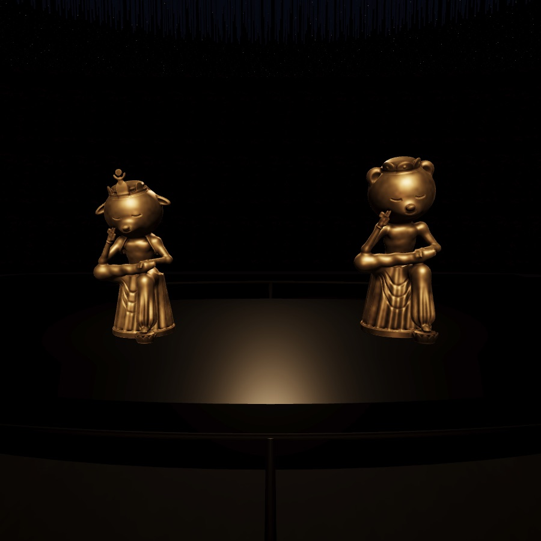
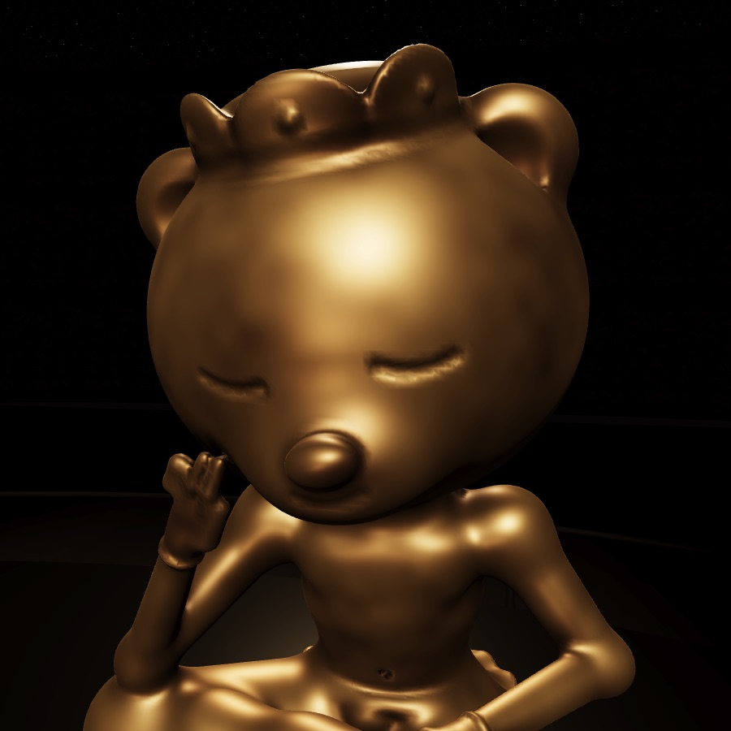
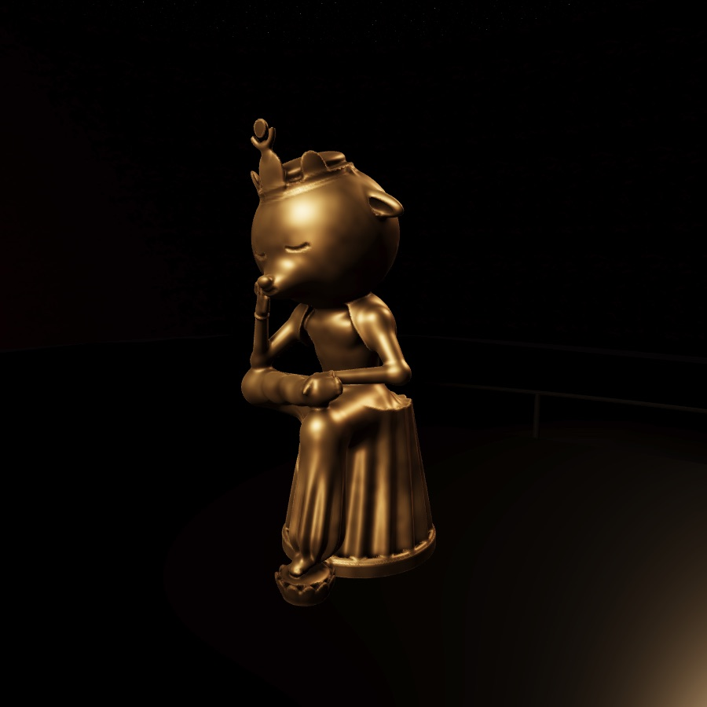
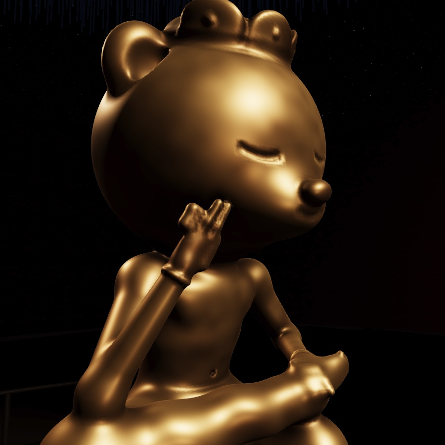

# 사유의 방

광장 오른쪽 아래(매표소를 등지고 오른쪽 뒤)에 문이 하나 더 있다. 표 없이 들어가는 `사유의 방`이다. 국립중앙박물관이 2021년 11월에 연 같은 이름의 전시실을 숲속 필하모닉에 옮겼다. 주소로 바로 들어가려면 `/?sayu`를 쓴다.

## 사람들이 왜 좋아하나

자료를 찾아보니 이유가 대체로 다섯 가지로 모인다.

1. **딱 두 점만 있는 방이다.** 국보 반가사유상 두 점은 전에는 석 달씩 번갈아 한 점만 전시됐다. 지금은 439㎡ 방에 둘만 나란히 상설로 앉아 있다. 사람들이 오래 바라던 일이었다는 평이 많다. 박물관이 반가사유상을 하나의 대표 콘텐츠로 세운 것이 성공했다는 분석도 있다.
2. **고요하고 비어 있다.** 어두운 방, 붉은 흙벽, 낮은 조명 덕분에 마음이 비워진다는 관람평이 많다. 조용할 때는 "시간과 장소를 넘어선다"는 연구사의 말도 실렸다. 해설판을 일부러 두지 않았다. 설명은 입구와 출구의 QR로 대신하고, 방 안에서는 각자 느끼게 한다.
3. **유리 없이 한 바퀴 돌아볼 수 있다.** 진열장이 없어서 앞, 옆, 뒤 360도로 볼 수 있다. 보는 각도에 따라 얼굴과 미소의 인상이 달라진다고들 한다. 동선도 휘어진 벽을 따라 두 상을 가운데 두고 자연스럽게 돌게 짜여 있다.
4. **공간이 몸으로 느껴지게 설계됐다.**
   - 밝은 곳에서 바로 들어오지 않도록 긴 어두운 복도에서 눈이 어둠에 적응할 시간을 준다.
   - 바닥은 두 상 쪽으로 1도 오르막이다. 사찰 계단의 경사에서 착안했다.
   - 천장에는 끝만 반짝이는 알루미늄 봉 약 2만 1천 개가 매달려 별 같은 분위기를 낸다.
   - 흙벽에서는 계피 향이 은은하게 난다.
   - 두 상만 빛을 되돌리고 나머지 재료는 빛을 먹어서 시선이 두 상에 모인다.
5. **굿즈와 입소문.** 개관 두 달 만에 11만 명, 첫해 66만 명이 다녀갔고, 2025년까지 약 100만 명이 찾았다. RM이 반가사유상 미니어처 사진을 올린 뒤 미니어처가 품절되면서 MZ 세대 사이에서 더 유명해졌다.

반대로 명상하러 온 사람에게는 붐비는 날 사람이 너무 많아서 여유를 느끼기 어렵다는 불만도 있다.

## 무엇을 어떻게 옮겼나

| 실제 사유의 방 | 숲속 사유의 방 |
| --- | --- |
| 들어갈 때와 나올 때 복도를 하나씩 지난다. 입장 복도 벽은 숯으로 칠했다. | 입장 복도는 약 21m에 살짝 굽어 있고 숯빛 벽이다. 반대편에 나가는 복도가 따로 있다. 둘 다 광장 문으로 이어진다(`SAYU.inWay`, `outWay`). |
| 눈이 어둠에 적응할 시간을 준다. | 들어서면 노출이 0.28에서 시작해 몇 초에 걸쳐 1로 올라간다(`ADAPT`, `adaptation()`). |
| 복도 초입에 우주가 퍼지고 물질이 순환하는 흑백 영상이 흐른다. | 왼쪽 벽 8.6m에 흑백 셰이더가 끝없이 바깥으로 열리며 흐른다. 낮은 화음과 가끔 맑은 고음이 들리고, 화면에서 멀어지면 작아진다. |
| 방은 세로 24m이고, 붉은 흙벽이 곡면으로 위로 벌어진다. | 슈퍼타원(n=4) 평면에 24m × 17m이다. 붉은 흙벽은 꼭대기에서 0.5m 바깥으로 기울어 있다. |
| 바닥은 두 상 쪽으로 1도 오르막이고 고목재다. | 입구에서 단상 앞까지 정확히 1도로 오르고, 그 뒤는 평평하다. 어두운 나무 바닥에 걸으면 캐릭터 높이도 따라 오른다. |
| 끝만 반짝이는 알루미늄 봉 2만여 개는 두 상 쪽으로 낮아진다. 상 위의 봉은 파랗고 나머지는 검다. | 봉 21,000개(폰은 끝 7,000개만)가 상 위에서 3.75m, 멀어질수록 4.9m까지 높아진다. 끝은 눈과 빛이 맞을 때만 반짝인다. 상 위 4.2m 안은 남색, 나머지는 검정이다. |
| 유리 없이 낮은 옻칠 타원 좌대와 차단봉만 있다. | 검은 옻칠 타원 좌대와 낮은 레일만 둔다. 레일 0.8m 앞까지 다가갈 수 있고, 뒤까지 한 바퀴 돈다. |
| 작은 왼쪽 상(6세기 후반)을 아주 약간 앞에 두었다. | 왼쪽 상을 4cm 앞에 두었다. 두 상의 키는 81.5:93.5 비율 그대로다. |
| 두 상만 빛을 되돌린다. | 두 상만 금동 재질이다. 나머지는 거칠고 어둡다. 상마다 정면 위에서 조명을 비추고, 뒤에서 은은하게 윤곽을 살린다. |
| 방 안에는 설명이 없다. | 이름은 입구 복도 벽에만 있고, 나가는 복도에 짧은 안내판 하나가 있다. |
| 흙벽의 계피 향 | 방에 들어서는 순간 안내 한 줄로 알려준다. |
| 조용하다. | 광장의 바람과 귀뚜라미 소리는 사라진다. 아주 작은 실내음과 내 발소리, 그리고 그 긴 잔향만 남는다. |

### 숲의 반가사유상

두 상은 숲의 동물로 앉아 있다.

- **왼쪽, 사슴(6세기 후반 상)**: 해와 초승달을 얹은 높은 관에 관대가 어깨까지 내려온다. 어깨를 덮는 숄을 걸쳤다.
- **오른쪽, 곰(7세기 전반 상)**: 세 봉우리의 낮은 관을 썼고, 상반신은 목걸이만 하고 맨몸이다.

자세는 실제 상과 같다.

- 오른 다리를 왼 무릎 위에 올렸다.
- 오른 팔꿈치를 그 무릎에 얹고, 두 손가락 끝을 뺨에 살짝 댔다.
- 고개는 손 쪽으로 숙였고, 눈은 내리감았으며 입가에 옅은 미소가 있다.
- 왼손은 오른 발목에 얹었다.
- 왼발은 연꽃 족좌를 딛는다.
- 치맛자락은 둥근 의자 위로 흘러내리며 앞쪽에 U자 주름을 겹겹이 만든다.

  

머리는 악단 동물과 같은 두개골(`body-shape.js`의 `HEAD`)이다.

상은 캡슐을 이어 붙이지 않았다. 거리장(SDF)으로 빚었다(`scene/sculpt.js`).

- 둥근 도형을 부드럽게 합치고 선을 새겨서, 표면 근처만 채운 격자에서 surface nets로 한 번에 메시를 만든다.
- 정점은 실제 표면으로 끌어당긴다.
- 법선은 거리장에서 구하고, 오목한 곳은 거리장 기반 AO로 어둡게 구워 넣는다.
- 갈색 금속 바탕에 도드라진 곳만 금빛이 남은 금동 녹을 정점색으로 칠한다.

데스크톱은 상당 약 28만 삼각형(격자 6.5mm), 폰은 13만(9.5mm)이다. 방에 들어서면 프레임 사이에 7ms씩 나눠서 깎는다. 복도를 걷는 동안 끝나고(이 Mac에서 데스크톱 3.5초, 폰 설정 1.7초), 60fps를 유지한다.

## 머무는 법

두 상에서 7.5m 안쪽에 들어오면 `F 가만히 바라보기`가 뜬다(터치는 버튼).

- 누르면 내 동물이 뺨에 앞발을 대고 고개를 기울인 채 두 상 쪽으로 돌아선다.
- 카메라는 어깨 옆으로 비켜서 두 상의 얼굴을 보며 천천히 흔들린다.
- 화면의 글자와 버튼은 모두 사라진다.
- 걷거나 화면을 끌면 끝난다.

다른 관람객 둘(폰 제외)은 앞자리를 비워두고 옆과 뒤에서 오래 서 있다. 그중 하나는 가끔 같은 자세로 생각에 잠긴다.

## 파일

- `public/js/scene/sayuRoom.js`: 공간, 빛, 봉, 영상, 좌대, 걸을 수 있는 곳(`walkable`), 바닥 높이(`floorY`), 카메라 높이 한도(`headroom`)
- `public/js/scene/pensive.js`: 두 상의 자세(`POSE`), 형태(`pensiveShapes`), 녹, 주조(`castPensiveStatue`)
- `public/js/scene/sculpt.js`: 거리장 도형, 매끈한 합치기와 새기기, surface nets, AO, 나눠 깎기
- `public/js/sayu.js`: 방문 흐름(눈 적응, 소리, 가만히 바라보기, 다른 관람객, 나가기)
- `public/js/plaza.js`, `scene/plazaWorld.js`: 광장의 넷째 문, 멀리 보이는 박물관, 같은 페이지 안에서 장면 바꾸기

## 검증

- `npm test`: `tests/sculpt.test.mjs`, `tests/sayu.test.mjs`
  - 메시가 거리장 표면 위에 있는지, 닫혀 있고 바깥을 향하는지
  - 1도 바닥, 상 위로 낮아지는 봉, 복도에서 방까지 이어지는 길, 레일 뒤까지 도는 동선
  - 왼쪽 상이 작고 앞에 있는지, 손끝이 뺨에 닿고 팔꿈치가 무릎 위에 있는지
  - 상이 받침 위에 서 있는지, 눈 적응 곡선
- `npm run verify:features` `PARTS=sayu`
  - 광장에서 표 없이 문으로 들어간다.
  - 노출이 0.29에서 0.98로 오른다.
  - 영상 소리(RMS 0.016)가 방 안(0.0012)보다 크다. 광장 소리는 0.08까지 줄었다가 나오면 0.86으로 돌아온다.
  - 두 상이 주조되고 바닥이 0.244m 오른다.
  - `F`로 바라보기를 켜면 화면이 비고, 앞발이 뺨에 닿는다(IK 오차 0). 걸으면 해제된다.
  - 나가는 복도로 광장에 돌아오면 주소와 노출이 원래대로 돌아온다.
  - 저장되는 PNG: `sayu-door.png`, `sayu-room.png`, `sayu-look.png`
- 두 상의 얼굴, 손, 관, 치맛자락은 고정 카메라(`place.inspect`)로 정면, 3/4, 옆, 뒤, 얼굴, 손, 무릎을 찍어서 눈으로 보며 고쳤다.

## 아직 확인하지 않은 것

- 실제 휴대폰에서 주조에 걸리는 시간과 프레임
- 소리를 귀로 들었을 때의 느낌
- 붐비는 상황(관람객은 둘뿐이다)
- 사파리와 파이어폭스

## 출처

- [Korea.net: Room of Quiet Contemplation 소개](https://www.korea.net/NewsFocus/Culture/view?articleId=245366)
- [The Korea Herald: 1주년 기사](https://www.koreaherald.com/article/3111802)
- [The Korea Times: 개관 두 달, 미니어처](https://www.koreatimes.co.kr/www/culture/2022/02/199_324559.html)
- [한국일보: 최욱 건축가 인터뷰](https://www.hankookilbo.com/news/article/A2021122109530004537)
- [리빙센스: 사유의 방 공간 설명서](http://www.living-sense.co.kr/news/articleView.html?idxno=62835)
- [Korea JoongAng Daily: 반가사유상 굿즈와 MZ 세대](https://www.koreajoongangdaily.com/business/pensive-bodhisattva-souvenirs-find-popularity-among-mz-generation/11307235)
- [세계일보: 사유의 방 약 100만 명](https://www.segye.com/newsView/20250727507658)
- [뉴닉: 국중박이 사랑받는 이유와 혼잡](https://newneek.co/@newneek/article/35116)
