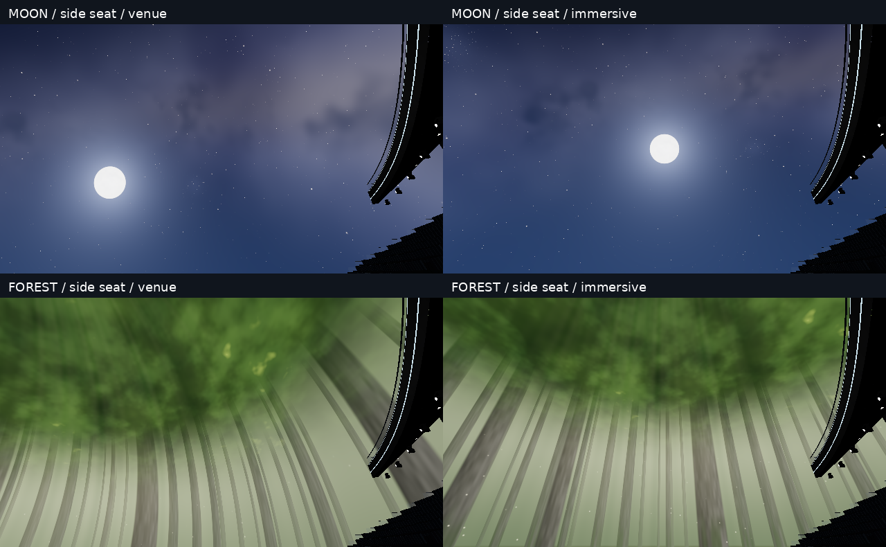
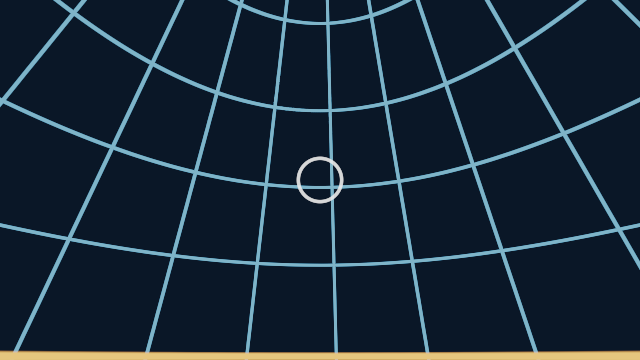
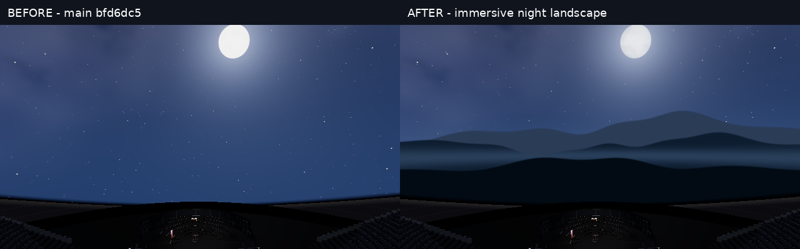

# 검증 기록

## 실행 환경 / 범위

- dot 클라우드 Linux 작업 공간. 사용자 PC/Codex 새 작업을 만들지 않았어.
- Node v24.19.0, 저장소 내 vendored Three.js. npm 의존성은 추가하지 않았어.
- Playwright를 통해 공식 Chrome for Testing 151.0.7922.34 headless shell을 실행했어. 기본 Chromium 실행 파일은 환경의 프로세스 소켓 제한으로 시작하지 못해서 이 실행 파일을 사용했어.
- 브라우저 renderer는 실제 하드웨어가 아니라 SwiftShader야. GPU/모바일/배터리/청취 성능은 검증 대상에서 제외해.
- 공식 Playwright 자동 다운로드가 잘못된 ZIP 응답으로 실패했어. 동일 공식 Chrome for Testing 배포를 직접 내려받아 실행했어. 제품 의존성/배포물에는 브라우저가 포함되지 않아.

## 자동 회귀

최신 main 5078d15 통합 및 유한 깊이 구현 후 `npm test`: **210 tests / 210 pass / 0 fail / 0 skipped**. 아래의 176개 기록은 1차 단계이며 최신 로그는 `tests-final-5078.log`야.

이 환경은 `os.networkInterfaces()`를 호출하면 `uv_interface_addresses` 오류가 나. 원본/후보 모두 서버의 LAN 주소 배너 단계에서 종료됐어. 서버 제품 코드를 바꾸지 않고 테스트 실행에만 다음 preloader를 적용했어. 실제 HTTP/WS 로직은 그대로 실행했으며, 이 보정 없는 실행이 통과했다고 보고하지 않아.

```js
const os = require('node:os');
try { os.networkInterfaces(); } catch { os.networkInterfaces = () => ({}); }
```

```sh
NODE_OPTIONS='--require=/tmp/sphere-network-shim.cjs' npm test
```

추가/보완한 검증:
- 자연 배경의 중심 광선이 수학적 플로어/좌우/상층 probe에서 동일함.
- 중앙 sweet spot에서는 이전/새 방향이 동일함.
- ARCH/CATHEDRAL/GOLD/DECO는 기존 화면에 고정함.
- 모바일 2D 대체 장면과 3D 큐브 장면에 같은 정책을 사용함.
- mode/calibration 변경이 시간·진행 장면을 초기화하지 않음.
- 두 패스가 projection/calibration uniform을 공유함.
- IMAG와 reveal은 screen 방향을 유지함.
- 정지 카메라의 모드 전환이 가시성 캐시를 무효화하고, 다음 정지 프레임은 재사용함.
- -Y 큐브 면을 명시적으로 요청하면 실제 렌더러 경로에 전달함.

기존 2개 가시성 기대값 검사가 새 기본 광선과 달라 처음에 실패했어. 기존 물리 투영의 기대값은 삭제하지 않고 `projection:'venue'`를 명시해 그대로 보존했어. 별도로 새 몰입 투영의 정확한 면 집합과 모드 복귀 검사를 추가했어. `buildDome()`의 단독 API 기본값은 이전 venue이며 앱 설정의 기본값만 immersive야.

## 수학적 근거

`node tools/bench/dome-projection-math.mjs docs/sphere-immersion/projection-math.json`

동일한 달 방향에 대해 기준점에서 생성한 스크린 위치를 다른 probe에서 보면 중심 방향 차이가 플로어 19.84°, 오른쪽 29.49°, 왼쪽 24.93°, 상층 27.32°였어. 새로운 관객 광선에서는 계산 정밀도 내 0°야. 이것은 **선택한 좌표에 대한 기하학 결과**이지 사용자 체감 개선율이나 전체 좌석의 왜곡 통계가 아니야. probe 좌표를 실제 앉을 수 있는 좌석이라고 주장하지 않아. 실제 앱 캡처 도구는 따로 가까운 실제 좌석을 찾아 눈높이를 올려 사용해.

## 미검증

물리 GPU/스마트폰의 FPS, 발열·배터리, Safari/iOS, VR 양안, 청음, 장시간 음악 동기화, 실제 고객의 몰입감 평가는 미검증이야. 기존 음악/네트워크 제품 코드는 수정하지 않았지만, 이것을 모든 기존 결함의 해소로 해석하면 안 돼.

## 1차 투영만 비교한 브라우저 결과 (30c223e 기반, 달빛 보강 전)

동일 후보의 venue/immersive 모드를 비교했어. 원본 baseline과 후보 전체를 A/B 실행한 결과라고 부르면 안 돼.

- 실제 앱 생성, 좌석 13,851개 유지, low/DPR1/640×360, 관객 0, 정지된 애니메이션.
- MOON/FOREST/ARCH × 중앙/측면/상층 × 2모드 = 18개 캡처.
- 중앙 MOON/FOREST 2쌍과 ARCH의 3시점 3쌍: RGB 차이 0, 원본 픽셀 동일.
- 측면/상층 자연 장면 4쌍: 의도한 방향 보정에 따른 차이. 수치가 큰 것을 품질 점수로 해석하지 않아.
- 측면 원본을 육안 확인했어. 달이 관객 시선의 고정된 방향에 나타나며, 오른쪽 객석/발코니 실루엣은 제자리를 유지해. 숲의 수관과 줄기가 관객을 감싸는 방향으로 바뀌어. 밝기·색상 grading 자체는 변경하지 않았어.
- 15도 투영 격자와 달의 각 크기 표적을 실제 셰이더로 렌더했어.
- 검사한 페이지에서 JS 예외/셰이더 에러 0. 설정 버튼 이벤트, `aria-pressed`, localStorage 저장값, 스피어 전용 필드 노출 확인.
- 각 관측의 2회 render+gl.finish 시간은 원본 JSON에 있지만, 표본이 너무 적고 이미지가 달라 **성능 개선 판정에 사용하지 않아**.

처음 full-app 캡처 시 임의 좌표를 사용했더니 구조물 안에 카메라가 들어가 검은 이미지가 나왔어. 최종 도구는 실제 좌석 목록에서 가까운 좌석을 선택하고 눈높이 1.25m를 더해 재실행했어. 이 초기 실패 이미지는 성공 증거에서 제외했어. 초기 page screenshot도 timeout이 나서, 최종 캡처는 실제 WebGL canvas를 렌더 직후 PNG로 추출했어. DOM UI 캡처가 아니라는 점도 구분해.





## PR #17 통합 단계

최종 기준 main은 bfd6dc534f3433cb07654876fc39ed1dfb8d8ff0이야. 투영 패치를 합친 뒤 10개 장면의 32개 캡처로 셰이더/설정을 다시 확인했어. 이 단계도 달빛 능선 보강 **전** 자료이며, 최종 아트의 전후 영상과 혼동하면 안 돼.

## 분리된 3D 세계 smoke (1차 투영 코드)

FOREST3D/OCEAN3D/CLOUDS3D/PEAKS3D 네 종류를 실제 WebGL로 렌더했고, 320×180 픽셀에서 각각 56,500 / 56,516 / 56,525 / 56,492개의 밝기 합 10 초과 픽셀을 얻었어. 셰이더 오류와 gl.getError는 0이었고, 두 큐브 장면 crossfade 중 투영 모드를 바꿔도 시간은 유지되고 overlay는 표시됐어. 밝은 픽셀 수는 검은 화면이 아님을 확인하는 약한 smoke 지표이지 화질 점수가 아니야. 이 검사는 full-app 음악/행동 검사가 아니고, 이후 바뀐 달빛 장면의 검증도 아니야.

## 최종 달빛 보강 후 회귀

최신 main 통합과 달빛 능선·달 표면 변경 후에도 176/176 tests, 실패/skip 0이야. 마지막 테스트 로그를 tests.log로 보존했어.

## 최종 원본/후보 카메라 경로 비교

`dome-immersion-video.mjs`를 실행해 bfd6dc5 원본과 달빛 보강 후보를 별도 서버에서 각각 24프레임 렌더했어. 두 페이지 모두 JS/셰이더 오류 0으로 기록됐어. 동일 640×360/DPR1/low, 관객0, 음악 시각25초, 공연 중 조명 조건이야. 카메라 경로는 진단용이고 실제 통행 가능한 동선이라고 주장하지 않아.

`immersion-comparison.mp4`는 두 원본 시퀀스를 나란히 배치한 4초/6fps 자료야. 이 6fps는 캡처 시퀀스 재생 속도일 뿐 실제 앱 성능이 아니야. 기준 프레임과 수정 프레임을 직접 확인했고, 하늘 아래에 능선·계곡 안개가 추가되며 객석은 같은 위치에 남는 것을 확인했어. 이 영상만으로 실제 관객의 몰입감이 좋아졌다는 심리 실험 결과를 주장하지 않아.



## 연구 후 재평가와 현재 상태

사용자의 추가 요청에 따라 실제 Sphere의 지각 원리를 조사했어. 넓은 물리적 시야와 감각의 일관성이 핵심이며, 관객별 시점 보정이 실제 Sphere의 핵심 원리인 것은 아니야. 이 구현의 viewer-relative 모드는 **가상 공연장의 선택 가능한 원경 표현**으로만 설명해야 해. 이를 실제 Sphere의 재현 정확도가 향상됐다는 근거로 사용하면 안 돼. 최신 연구 설명 때 PR 제출을 잠시 보류했지만, 사용자가 이후 원리를 적용해 구현하라고 승인하여 2차 깊이 단서 구현과 PR 준비를 재개했어.

## 2차 깊이 단서 구현과 최신 main 통합

- 최종 기준을 PR #18이 병합된 5078d15로 갱신했어. 최신 곡 선택/재생 종료 동기화/오디오 복구 코드를 보존했으며 충돌 없이 rebase했어. #15는 실제 iPhone 확인이 남아 있어 구현 존재와 실기기 검증 완료를 구분해야 해.
- 전체 Node 테스트 210/210, Python benchmark 도구 테스트 5/5 통과. `tests-final-5078.log`, `python-final.log`를 보존해.
- 유한 깊이 shader 변경 후 10장면·32캡처, JS/셰이더 오류 0, 설정 venue 전환/저장/aria-pressed 확인. `browser-depth.json` 참고. 이 세션은 rebase 전에 시작했으므로 최종 깊이 shader 검증이지만 PR #18 통합 앱 전체 검증으로 확대하지 않아.
- 같은 후보의 두 투영 모드를 픽셀 비교한 결과, 중앙 MOON/FOREST 및 ARCH의 세 위치는 정확히 일치했어. 측면/상층 자연 장면은 달라졌어. `pixel-depth.json`의 픽셀 차이는 모드 차이를 확인하는 지표이지 몰입/품질 점수가 아니야.
- 최종 전후 영상의 첫 실행은 baseline 준비 단계 240초 제한시간을 초과해 실패했어. 후보 영상 프레임을 얻기 전이므로 성공 증거로 세지 않아. 동시 실행을 피하고 준비 제한시간을 600초로 늘려 재실행했어. 동시 실행이 유일한 실패 원인이라고 단정하지 않아.

현재 증거 커밋 시점에는 5078d15와의 2차 전후 영상이 생성 중이야. 기존 `immersion-comparison.mp4`는 1차 bfd6dc5 비교이며 유한 깊이 버전의 영상으로 제시하지 않아. 최종 영상과 결과는 후속 증거 커밋에 추가해.

## 2차 영상 완료

- 5078d15 원본과 e2ff290 제품 트리의 후보를 각자 서버에서 실행해 MOON/FOREST 각각 48프레임, 양쪽 합계 192프레임을 완주했어. 양쪽 JS/셰이더 오류 배열은 모두 비어 있어. `depth-video-report.json` 참고.
- 동일 seed/카메라 경로/640×360/DPR1/low/관객0이며 같은 결정적 합성 level 입력을 사용해. 실제 음악 오디오를 재생/청취한 시험이 아니야. 경로는 비교용이며 실제 보행 가능한 통로를 검증한 것도 아니야.
- `depth-comparison.mp4`: 왼쪽 원본, 오른쪽 후보, 앞 4초 MOON/뒤 4초 FOREST. 1280×420, H.264, 12fps, 96프레임, 8초. 12fps는 캡처 시퀀스의 재생 속도이며 앱 성능이 아니야. ffmpeg 전체 디코딩 검사 성공.
- `depth-comparison.png`: 양쪽의 동일한 12번/60번 프레임을 배치한 정지 비교. 달빛의 겹친 능선·안개와 숲의 상대 위치를 검토할 수 있지만 정지 그림 자체가 운동 시차를 입증하지 않아.
- 실제 코드 경로의 시간에 따른 상대 변화를 영상으로 확인했고, 중심/측면/상층 정지 비교 및 수학 테스트와 함께 판단해. 주관적 몰입/멀미/실폰 성능은 여전히 미검증이야.
- 재현: 먼저 `dome-immersion-video.mjs`로 두 서버의 프레임을 만든 뒤 `OUTPUT_DIR=<출력 경로> bash tools/bench/dome-immersion-encode.sh`로 영상을 묶어. ffmpeg와 DejaVu Sans가 있는 환경의 선택적 증거 생성 도구이며 제품 실행 의존성은 아니야.
- 제품 커밋 e2ff290의 GitHub CI: Ubuntu Node 18/22와 Windows Node 22, GitGuardian 모두 success를 확인했어. 기존 Vercel 연동의 PR preview도 자동 생성됐어. 별도 배포 설정 변경/운영 배포/main 병합/Sites 갱신은 하지 않았어.
